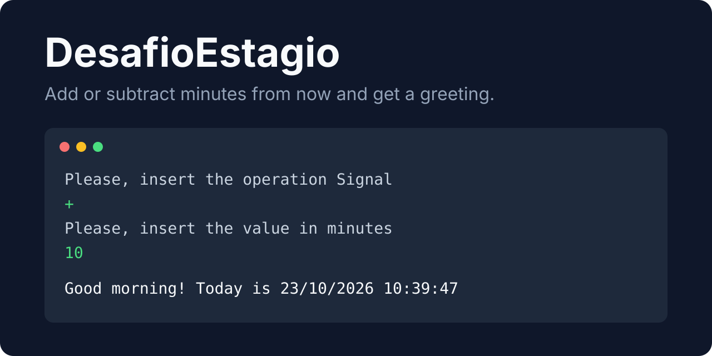
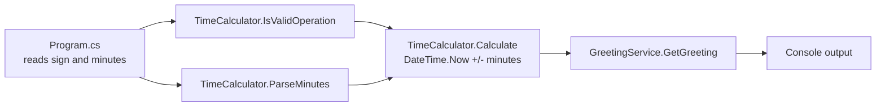

<div align="center">

# DesafioEstagio

**A .NET Framework console application with full CI/CD pipeline.**<br/>
Type `+` or `-` and a number of minutes; it prints the shifted date and a time-of-day greeting.

[](https://github.com/juninmd/DesafioEstagio/actions/workflows/ci.yml)
[](https://github.com/juninmd/DesafioEstagio/actions/workflows/security.yml)
[](https://dotnet.microsoft.com/)

<br/>



</div>

## Usage

Run the built executable and answer two prompts: the operation sign (`+` or `-`) and the value in minutes. The app applies it to the current time and greets according to the resulting hour.

```text
Please, insert the operation Signal 
(Example: - or +)
+
Please, insert the value in minutes 
(Example: 10 or 30)
10
Good morning! Today is 23/10/2026 10:39:47
```

Invalid input prints `Error: <message>` instead of crashing, for example `Error: You should use only (+ or -)` for any sign other than `+` or `-`.

| Hour of the resulting time | Greeting |
|---|---|
| 07:00 to 11:59 | Good morning |
| 12:00 to 17:59 | Good afternoon |
| 18:00 to 06:59 | Good evening |

## How it works



`Program.cs` only handles console I/O and error reporting. Date arithmetic lives in `TimeCalculator.cs` and the greeting rule in `GreetingService.cs`, so both are covered by unit tests without touching the console.

## Project Structure

```
DesafioEstagio/
├── DesafioEstagio/           # Main application
│   ├── Program.cs            # Entry point
│   ├── GreetingService.cs    # Greeting logic
│   ├── TimeCalculator.cs     # Time calculation logic
│   ├── App.config            # Application configuration
│   └── Properties/
├── DesafioEstagio.Tests/     # Test project
│   ├── UnitTests/            # Unit tests (business logic)
│   ├── IntegrationTests/     # Integration tests (full flow)
│   ├── E2ETests/             # End-to-end tests (console I/O)
│   └── Properties/
├── .github/workflows/        # GitHub Actions CI/CD
├── .editorconfig             # Code style rules
├── .env.example              # Environment variables template
└── CONTRIBUTING.md           # Contribution guidelines
```

## Prerequisites

- Windows 7+ or Windows Server 2012+
- Visual Studio 2015+ or MSBuild
- .NET Framework 4.6.1 SDK

## Build

```powershell
# Restore packages
nuget restore DesafioEstagio.sln

# Build
msbuild DesafioEstagio.sln /p:Configuration=Release

# Or open DesafioEstagio.sln in Visual Studio
```

## Test

```powershell
# Build tests
msbuild DesafioEstagio.sln /p:Configuration=Debug

# Run tests
vstest.console.exe DesafioEstagio.Tests\bin\Debug\DesafioEstagio.Tests.dll
```

## CI/CD Pipeline

| Stage | Description | Trigger |
|-------|-------------|---------|
| Lint | Code style and static analysis | Every push/PR |
| Test | Run unit, integration, and E2E tests | After lint |
| Security | Secret scanning and vulnerability check | After lint |
| Build | Release build with optimizations | After test |
| Deploy Staging | Auto-deploy to staging | PR to main or push to develop |
| Deploy Production | Manual approval required | Push to main |
| Notify | Build status summary | After all stages |

## Deployment

- **Staging**: Automatically deployed when PRs are merged to `develop`
- **Production**: Requires manual approval via GitHub Environments

## Quality Gates

- Code coverage >= 80%
- All tests must pass
- No security vulnerabilities
- Linting standards enforced
- Files under 180 lines

## Configuration

The application reads no environment variables or settings. `App.config` only pins the runtime (`v4.0`, .NET Framework 4.6.1). `.env.example` is a template for pipeline and deployment values; nothing in the code or the workflows reads it today.

## Known limitations

- The app ends with `Console.ReadKey()`, which throws `InvalidOperationException` when stdin is redirected (pipes, CI), so it cannot be scripted as is. Run it from an interactive console.
- Times from 06:00 to 06:59 get "Good evening", because the morning rule starts after hour 6 (`data.Hour > 6`).
- Minutes must be a plain integer that fits in `int`; anything else prints `Error: Minutes must be a valid integer`.
- Staging and production deploy steps in `ci.yml` only echo notices; no real deployment target is configured.

## Contributing

See [CONTRIBUTING.md](CONTRIBUTING.md) for detailed guidelines.

## License

No `LICENSE` file is published in this repository yet.
